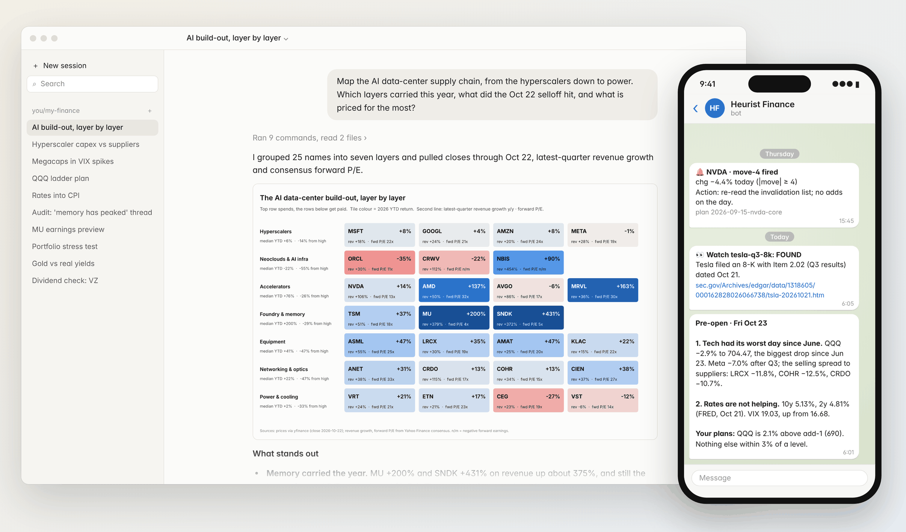
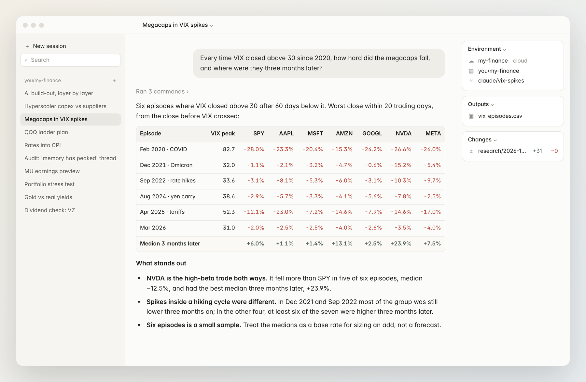
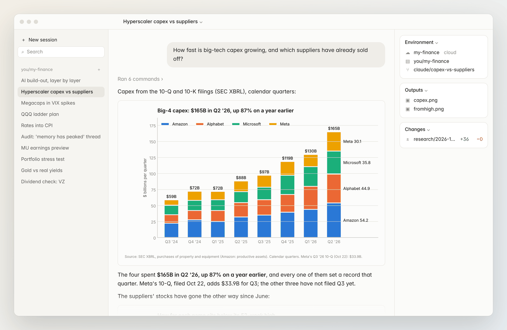
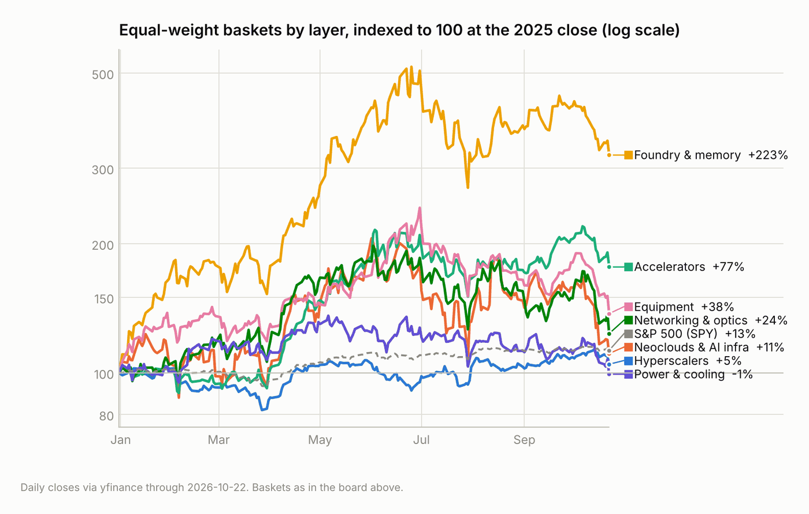
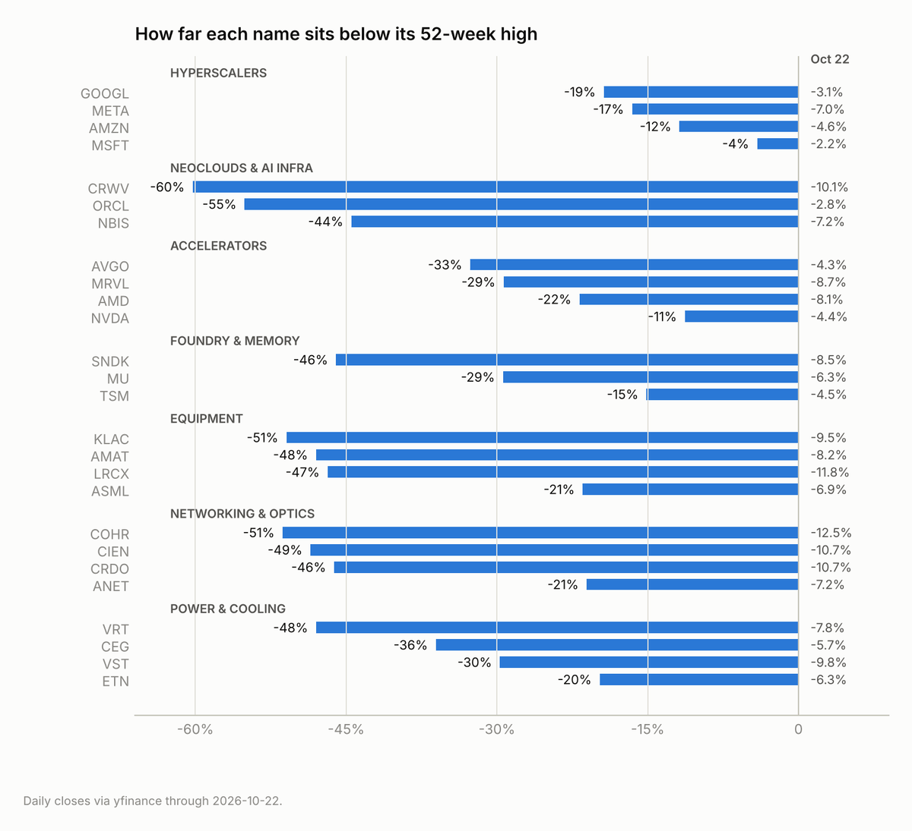
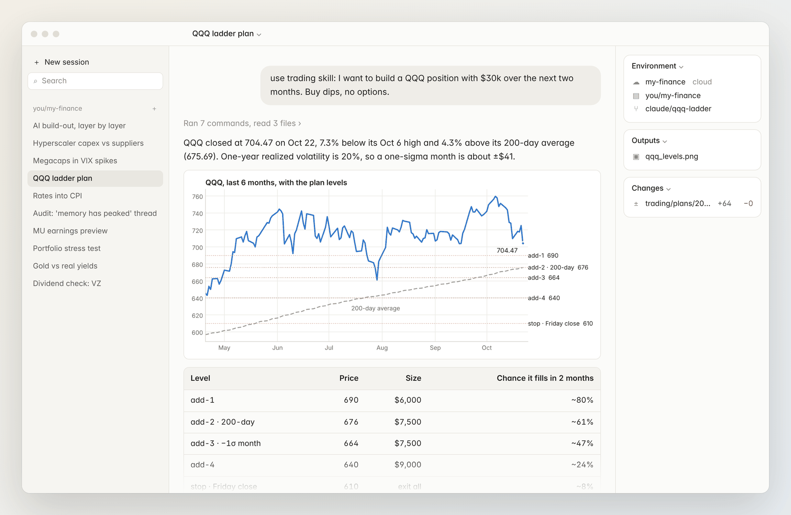
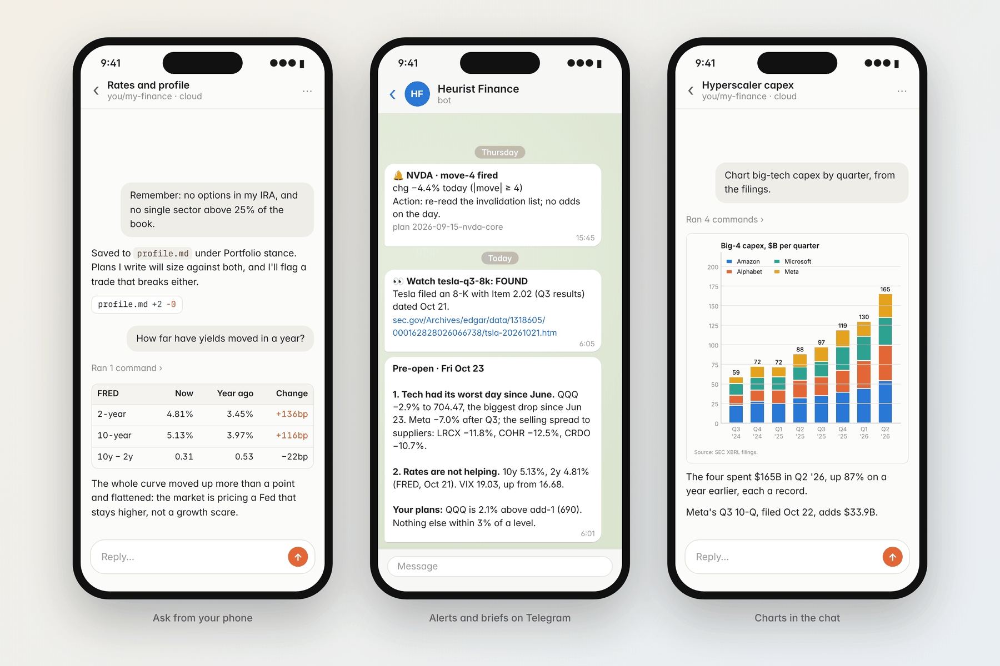

<h1 align="center">Heurist Finance</h1>

<p align="center">
An AI research desk for your own investing, kept in a git repo you own.<br>
Ask market questions from your laptop or your phone. Get tables, charts and a straight answer.<br>
Write trading plans, and get a Telegram message when one of your price levels is hit.
</p>

<p align="center">
<a href="#get-started">Get started</a> ·
<a href="#what-you-can-ask">What you can ask</a> ·
<a href="#plans-that-watch-the-market">Plans and alerts</a> ·
<a href="#26-skills">Skills</a> ·
<a href="https://finance.heurist.ai">finance.heurist.ai</a>
</p>



Open this repo in Claude Code, Codex or Cursor and ask a question the way you'd ask an analyst.
The agent pulls prices, options, fundamentals, SEC filings, FRED series and the web through
[Heurist Mesh](https://heurist.ai), does the arithmetic, and comes back with tables, charts and
a view it is willing to be wrong about. Your profile, plans, trades and research notes are plain
Markdown files in the repo, so the next session, or a different agent, picks up where the last
one stopped.

If you'd rather use a hosted app, [finance.heurist.ai](https://finance.heurist.ai) is an AI
financial workbench where you read the market feed and research with AI in the browser.

<sub>The screens on this page are mockups. They use real closes through Oct 22, 2026, real SEC
filings and FRED data; the wording of the replies is illustrative.</sub>

## What you can ask

Anything you'd hand to an analyst with a terminal and an afternoon:

- *Map the AI data-center supply chain, from the hyperscalers down to power. Which layers carried this year, and what is priced for the most?*
- *Every time VIX closed above 30 since 2020, how hard did the megacaps fall, and where were they three months later?*
- *Chart big-tech capex by quarter, from the filings.*
- *Is this rally narrow? Compare equal-weight and cap-weight S&P 500 since 2023.*
- *Preview Micron's earnings: what does the options market imply, and what would move the stock 10%?*
- *Fact-check this thread: (paste it)*
- *What does a 100bp jump in the 10-year do to my portfolio?*



The agent is told to take every number from a tool call made in that session, never from
memory. It works out its own estimate before it reads consensus, counts independent sources rather than
repeated ones, and ends with a call, what would prove it wrong, and a time horizon.

## Charts and tables

When a picture answers the question faster, the agent writes a short plotting script, runs it
and shows you the chart in the conversation. In the cloud app the images sit next to the chat
under Outputs.



<table>
<tr>
<td width="54%"></td>
<td width="46%"></td>
</tr>
</table>

## Plans that watch the market

Say what you want to do and the `trading-plan` skill turns it into a one-page plan: thesis,
scenarios with odds, size, what would make you exit, and price levels. The levels go into the
file's frontmatter, where a small monitor can read them.



A level can watch more than the price: the daily close, the 200-day average, a day's percentage
move, an index such as `^VIX`, or any FRED series, such as high-yield credit spreads. For
conditions that need reading rather than a number ("tell me when the 8-K with the merger vote
date is filed"), you write a watch in plain English and an agent checks it every morning.

Three scripts do the watching, run from cron on any always-on machine:

| Script | What it does |
|---|---|
| `monitor.py` | Checks every active plan, every 15 minutes in market hours, and messages you when a level fires |
| `watch.py` | Gives each plain-English watch to an agent, which reports a finding or stays quiet |
| `brief.py` | A pre-open and after-close brief on what touched your positions and plans |

## On your phone

Claude Code sessions can run in the cloud, so you can start one from the Claude app on your
phone, ask a question on the train, and pick the same session up on your laptop later.
Alerts and briefs go to a Telegram bot you create.



Telegram is the default, not a requirement. Every message goes through one function in
[`src/notify.py`](src/notify.py), so sending to Slack, Discord, email or your own webhook is a
small change you can ask the agent to make. What fires, and when, is defined in your own plan
and watch files.

## It remembers you

- **`profile.md`** holds your constraints, your risk tolerance, what never to pitch, and the
  mistakes you tend to repeat. Ask the agent to interview you and it fills this in.
- **`trading/trades.md`** has one row per fill, each tied to the plan level it executed or
  marked `unplanned`. A screenshot of a broker receipt is enough to log one.
- **`trade-postmortem`** grades closed trades on process, not P&L, and adds a lesson to your
  profile only when three or more trades show the same pattern.
- **`context/`** keeps the daily brief's notes (prices, stories with links, open questions), so a
  new session starts from what was known this morning.

The profile shapes the analysis without steering it. The agent is told to bring up the strongest
ideas outside your current book, and to say so once, with evidence, when it thinks a past
decision was wrong.

## 26 skills

The agent picks a skill from your question, or you name one with its phrase.

| Area | Skills (phrase) |
|---|---|
| Research | [research](.claude/skills/hf-research/SKILL.md) · [earnings-preview](.claude/skills/earnings-preview/SKILL.md) · [audit](.claude/skills/thesis-audit/SKILL.md) · [valuation](.claude/skills/valuation-expectations/SKILL.md) · [forensics](.claude/skills/fundamental-forensics/SKILL.md) · [screener](.claude/skills/stock-screener/SKILL.md) |
| Markets | [market](.claude/skills/market-health/SKILL.md) · [macro](.claude/skills/macro-regime/SKILL.md) · [sector](.claude/skills/sector-rotation/SKILL.md) · [sentiment](.claude/skills/sentiment-positioning/SKILL.md) · [momentum](.claude/skills/momentum-trend/SKILL.md) · [technicals](.claude/skills/technical-evidence/SKILL.md) |
| Trading | [trading](.claude/skills/trading-plan/SKILL.md) · [timing](.claude/skills/entry-exit-timing/SKILL.md) · [sizing](.claude/skills/position-sizing/SKILL.md) · [options](.claude/skills/options-strategist/SKILL.md) · [earnings](.claude/skills/earnings-play/SKILL.md) · [postmortem](.claude/skills/trade-postmortem/SKILL.md) |
| Portfolio | [portfolio](.claude/skills/portfolio-review/SKILL.md) · [pairs](.claude/skills/pairs-relative-value/SKILL.md) · [dividend](.claude/skills/dividend-income/SKILL.md) |
| Special situations | [event](.claude/skills/event-driven/SKILL.md) · [short](.claude/skills/short-thesis/SKILL.md) · [smallcap](.claude/skills/small-cap-scout/SKILL.md) · [commodity](.claude/skills/commodity-curve/SKILL.md) · [bond](.claude/skills/bond-data/SKILL.md) |

For example: `use earnings-preview skill: NVDA`, or `use audit skill:` followed by a pasted thread.

## Get started

You need two API keys: [Heurist](https://heurist.ai/credits) for Mesh (Yahoo Finance, FRED, SEC
EDGAR and web search; or [apply with a referral code](https://dev-api-form.heurist.ai/)) and [EODHD](https://eodhd.com) for daily prices.

**1. Make a private copy.** Your plans and fills get committed, so keep them out of a public repo
(a GitHub fork of a public repo can't be made private). Create an empty private repository,
then:

```bash
git clone https://github.com/heurist-network/heurist-finance my-finance
cd my-finance
git remote set-url origin git@github.com:<you>/my-finance.git
git push -u origin main
```

**2a. In the cloud.** Open [claude.ai/code](https://claude.ai/code), choose your private repo and
create an environment for it:

- Add `HEURIST_API_KEY` and `EODHD_API_KEY` as environment variables.
- Set the setup script to `uv sync`.
- Allow full network access, because research reads filings and pages from many sites.

Sessions you start on the web or in the Claude app then run against your repo.

**2b. On your machine.** With Python 3.11+, [uv](https://docs.astral.sh/uv/) and a coding agent:

```bash
cp .env.example .env        # add HEURIST_API_KEY and EODHD_API_KEY
uv sync
uv run python scripts/hf_tool.py quote NVDA QQQ
claude                      # or codex, cursor
```

**3. Introduce yourself.** Start with `Interview me and fill in profile.md`, then ask your first
question.

**Alerts and briefs (optional).** Create a Telegram bot with `@BotFather` and put
`TELEGRAM_BOT_TOKEN` and `TELEGRAM_CHAT_ID` in `.env` on an always-on machine. The brief and
watches also need `ANTHROPIC_API_KEY`. [AGENTS.md](AGENTS.md#daily-brief) has the crontab.

## Under the hood

[AGENTS.md](AGENTS.md) is the manual the agents read: the repo layout, the plan format, the
market data CLI, and the rules every answer follows. Read it if you want to change how any of
this works. The agents behind the brief and the watches run unattended, so they can read only
inside the repo, can't read your keys, and can't edit files.

Up to 0.10.4 this repo was a Node terminal app (`hf`). That code is in the git history at commit
`1c77563`.

## License

MIT
